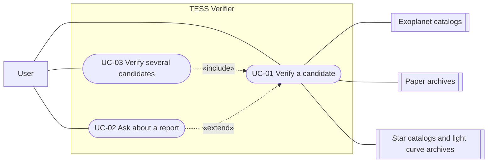

# Use Cases

Use cases describe who uses TESS Verifier and what they do with it. They follow the [vision](vision.md), each step names the [requirements](requirements.md) it covers, and terms are defined in the [glossary](glossary.md).

## Notation

- **UC** (use case) - one goal an actor reaches with the system.
- **Priority** - the same as in the [requirements](requirements.md#notation): **Must**, **Should** or **Could**.
- **Main success scenario** - the steps when everything goes as planned.
- **Extensions** - what happens when a step goes differently. `2a` branches off step 2, `*a` can happen at any step. Unless an extension says the use case ends, it continues with the next step.

## Actors

| Actor | Type | Goal / role |
|---|---|---|
| User: student or amateur astronomer | Primary (main user) | Wants to know whether a candidate is likely a planet and why, e.g. to choose what to observe. Knows what a transiting planet is, but not how false positives are ruled out. Reports are written for this user (NFR-05). |
| User: researcher | Primary | Knows how candidates are vetted. Uses the system for a quick first pass over many candidates (mostly UC-03) and follows the links to check the sources (FR-14). The system does not assume this knowledge, so the reports are the same for both users. |
| Exoplanet catalogs | Supporting (external system) | Provide the list of TOIs, each candidate's disposition, and the timing and depth of its dips, e.g. NASA Exoplanet Archive (TOI table), ExoFOP-TESS. |
| Paper archives | Supporting (external system) | Provide scientific papers that mention a candidate, e.g. arXiv, NASA ADS. |
| Star catalogs and light curve archives | Supporting (external system) | Provide stars near the target, light curves and pixel data, e.g. TESS Input Catalog (TIC), MAST. |

In the rest of this document, *user* means either kind of user. Links to the external systems are in [useful links](useful-links.md).

## Overview

| ID | Use case | Primary actor | Priority | Requirements |
|---|---|---|---|---|
| [UC-01](#uc-01-verify-a-candidate) | Verify a candidate | User | Must | FR-01 - FR-14 |
| [UC-02](#uc-02-ask-about-a-report) | Ask about a report | User | Should | FR-15 |
| [UC-03](#uc-03-verify-several-candidates) | Verify several candidates | User | Could | FR-16 |

---

## UC-01: Verify a candidate

The user gives a candidate's TOI number. The system checks catalogs and papers, runs the tests that fit the candidate and shows a report with one verdict.

- **Priority:** Must
- **Primary actor:** User
- **Supporting actors:** exoplanet catalogs, paper archives, star catalogs and light curve archives
- **Trigger:** the user wants to know whether a candidate is likely a planet.
- **Preconditions:** none.
- **Success guarantee:** the user sees a report with the candidate's disposition, the papers about it, the tests run and skipped with reasons, exactly one verdict with its main reason, and links to every outside source.
- **Minimal guarantee:** if no report can be made, the user is told why: which input or data is missing, or which source could not be reached.

### Main success scenario

| Step | Actor | Action | Requirements |
|---|---|---|---|
| 1 | User | Enters a candidate's TOI number, e.g. `TOI-1234.01`. | FR-01 |
| 2 | System | Finds the candidate in the exoplanet catalogs and gets its disposition (e.g. *planet candidate*) with source and date, and the timing and depth of its dips. | FR-03, FR-14 |
| 3 | System | Finds papers that mention the candidate. For each one it notes the title and year, and whether the paper confirms the candidate, rules it out or only mentions it. | FR-04, FR-05, FR-14 |
| 4 | System | Looks for stars within 2.5 arcminutes of the target that are bright enough that eclipsing one of them completely would produce the dip, and finds none. | FR-07 |
| 5 | System | Runs the tests that fit the candidate. It always checks whether the dip could come from two stars eclipsing each other. For each test it records why it was run or skipped. | FR-06, FR-08 |
| 6 | System | Marks each test that was run as *passed* (fits a planet), *failed* (points to a false positive) or *unclear*. | FR-09 |
| 7 | System | Every needed test passed, so the verdict is *likely planet*. The system states the main reason in one sentence. | FR-10, FR-11 |
| 8 | System | Shows the report: disposition, papers, tests run and skipped with reasons and results, the verdict with its main reason, and links to every outside source. | FR-08, FR-09, FR-10, FR-14 |

After step 8 the user can ask about the report ([UC-02](#uc-02-ask-about-a-report)).

### Extensions

#### \*a. An external source cannot be reached
1. The system tells the user which source failed.
2. If it is the exoplanet catalogs, the candidate cannot be found and the use case ends. Otherwise the system continues: the report shows what is missing, and tests that need the missing data are skipped with that reason. (FR-02, FR-08)

#### 1a. The input is not a valid TOI number (e.g. `TOI-abc`)
1. The system shows the expected form, e.g. `TOI-1234.01`.
2. The user enters the number again and the use case goes back to step 1. (FR-02)

Whether a TOI without its suffix (e.g. `TOI-1234`) or a TIC number should also be accepted is an [open question](requirements.md#open-questions).

#### 2a. The candidate is not in the catalogs
1. The system tells the user that no candidate with this number was found. The use case ends. (FR-02)

#### 2b. The candidate is already confirmed or ruled out in the catalogs
1. The system still runs its own checks (steps 3-8).
2. The report shows the catalog disposition next to the system's verdict and points out when they disagree. (FR-03, FR-10)

This behavior is provisional until the [open question](requirements.md#open-questions) about already resolved candidates is answered.

#### 3a. No papers mention the candidate
1. The report says that no papers were found. This is not an error and the use case continues. (FR-04)

#### 4a. A bright enough star lies within 2.5 arcminutes
1. Before the other tests, the system checks which star the dip comes from (centroid test). (FR-07)
2. The use case continues at step 5. If the dip comes from the other star, this test fails (see 7a).

#### 5a. The data for a test are missing or too poor
1. If the data are missing, the system skips the test. If they are too poor, it marks the test as *unclear*. Either way it records the reason. (FR-02, FR-08, FR-09)
2. The use case continues. If a needed test gives no result, the verdict is *inconclusive* (see 7b).

#### 7a. At least one test failed
1. The verdict is *false positive*.
2. The report names the likely cause, e.g. two eclipsing stars or a nearby star. (FR-11, FR-12)

#### 7b. No test failed, but not every needed test passed
1. The verdict is *inconclusive*.
2. The report names the observation or data that would settle it, e.g. high-resolution imaging from the ground. (FR-11, FR-13)

---

## UC-02: Ask about a report

The user asks follow-up questions about a report they have just received.

- **Priority:** Should
- **Primary actor:** User
- **Supporting actors:** none
- **Trigger:** the user has a question about a report, e.g. what a test means or why it was skipped.
- **Preconditions:** a report from UC-01 or UC-03 is shown in the current session.
- **Success guarantee:** the user gets an answer based on the report, with links for facts from outside sources.
- **Minimal guarantee:** the system does not make up an answer. If it cannot answer, it says so and why.

### Main success scenario

| Step | Actor | Action | Requirements |
|---|---|---|---|
| 1 | User | Asks a question about the report, e.g. why a test was skipped or what a result means. | FR-15 |
| 2 | System | Answers using the report and the data behind it, with links to the outside sources it relies on. | FR-14, FR-15 |
| 3 | User | Repeats steps 1-2 until they have no more questions. | FR-15 |

### Extensions

#### 2a. The question is not about the report (e.g. it is about another candidate)
1. The system says it can only answer questions about this report and suggests what to do instead, e.g. checking the other candidate (UC-01).

#### 2b. The answer needs data the report does not have
1. The system says which data would be needed and does not guess.

Whether the user can come back to a report from an earlier session is an [open question](requirements.md#open-questions).

---

## UC-03: Verify several candidates

The user gives several TOI numbers at once and gets one list of verdicts.

- **Priority:** Could
- **Primary actor:** User
- **Supporting actors:** the same as in UC-01
- **Trigger:** the user wants to compare several candidates, e.g. to choose which ones to observe.
- **Preconditions:** none.
- **Success guarantee:** the user sees one list with each candidate's verdict and main reason, *likely planet* candidates first, and can open the full report of each candidate.
- **Minimal guarantee:** every candidate from the input is either in the list or reported as not checked, with the reason.

### Main success scenario

| Step | Actor | Action | Requirements |
|---|---|---|---|
| 1 | User | Enters several TOI numbers, e.g. `TOI-1234.01, TOI-5678.01`. | FR-16 |
| 2 | System | Checks each candidate as in UC-01, steps 2-8. | FR-16 |
| 3 | System | Shows a list with each candidate's verdict and main reason, *likely planet* candidates first. | FR-16 |
| 4 | User | Opens the full report of a chosen candidate and can ask about it ([UC-02](#uc-02-ask-about-a-report)). | FR-01 |

### Extensions

#### 1a. Some of the numbers are not valid TOI numbers
1. The system lists the invalid numbers and checks the rest. If none is valid, the use case ends. (FR-02)

#### 2a. A candidate cannot be checked (e.g. it is not in the catalogs or a source cannot be reached)
1. The candidate is shown at the end of the list as *not checked*, with the reason. The other candidates are checked as usual. (FR-02)

---

## Open questions

Open questions about the requirements are listed in [requirements](requirements.md#open-questions). Some of them affect UC-01 (1a, 2b) and UC-02. These come from the use cases:

- How many candidates can UC-03 take at once? With up to 10 minutes per candidate (NFR-04), 20 candidates can take over 3 hours.
- Should the system retry an external source that cannot be reached (UC-01, \*a), and for how long?

## Quality requirements

Limits on accuracy, citations, consistency, speed and clarity of reports apply to all use cases. They are listed as NFR-01 - NFR-05 in [requirements](requirements.md#non-functional-requirements).
